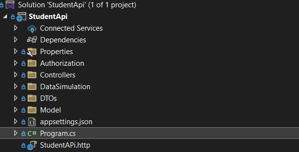
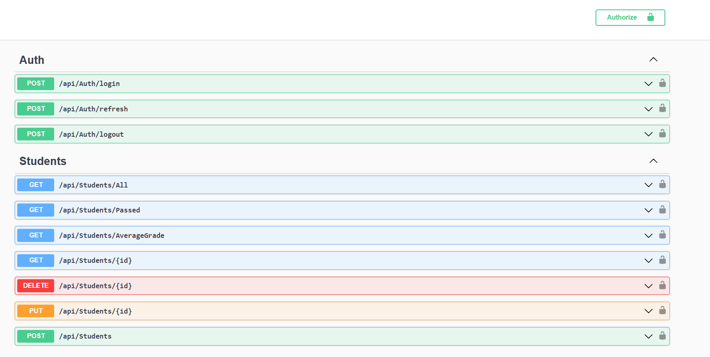

<div align="center">

# 🔐 Secure Student API


A clean **ASP.NET Core Web API** for student data management, secured with **JWT Bearer Authentication** — including access tokens, refresh tokens, and logout. Built with in-memory data simulation, DTOs, and a custom authorization layer.

**👨‍💻 Author:** Marnissi Ahmed Mustapha &nbsp;|&nbsp; **📅 Last Updated:** November 2026

[](https://github.com/AhmedMustaphaMarnissi)

</div>

---

## ⚡ TL;DR

A focused Web API project that implements **JWT authentication end-to-end**: login, token refresh, and logout — protecting a set of student CRUD and analytics endpoints. No database, no EF Core — data is simulated in-memory via a `DataSimulation` layer. The project is structured with Controllers, DTOs, Models, and a custom `Authorization` folder, all wired through `Program.cs`.

👉 The goal isn't a production student system — it's practicing **secure API design** with proper token lifecycle management.

---

## 💡 Key Highlights

- Full JWT Bearer Authentication — login, refresh token, and logout endpoints
- All `Students` endpoints are protected with the 🔒 lock icon (require valid JWT)
- `Auth` endpoints handle the full token lifecycle: issue → refresh → invalidate
- In-memory data simulation via `DataSimulation` — no database required
- DTO layer (`DTOs` folder) separating API contracts from internal models
- Custom `Authorization` folder for JWT configuration and token logic
- Swagger UI with **Authorize** button for testing protected endpoints directly
- 7 endpoints across 2 controller groups: `Auth` (3) and `Students` (4 GET/PUT/POST/DELETE)

---

## 📋 Table of Contents

- [Overview](#overview)
- [Project Structure](#-project-structure)
- [API Endpoints](#-api-endpoints)
  - [Auth Controller](#-auth-controller)
  - [Students Controller](#-students-controller)
- [Tech Stack](#tech-stack)
- [Getting Started](#getting-started)
- [What I Learned](#-what-i-learned)

---

## Overview

**Secure Student API** is an ASP.NET Core Web API that manages a student dataset through a set of RESTful endpoints, all protected behind JWT Bearer authentication. The project demonstrates a complete authentication flow: a client logs in and receives an access token, uses it to call protected student endpoints, refreshes it before expiry, and logs out to invalidate the session.

Data is provided by a `DataSimulation` layer rather than a real database, keeping the focus entirely on the API structure and security implementation. The Swagger UI includes the **Authorize** button to inject a Bearer token and test all protected routes directly in the browser.

---

## 🗂️ Project Structure

The Visual Studio solution `StudentApi` is organized into clearly separated folders:

```
StudentApi/
├── Authorization/        # JWT configuration, token generation & validation logic
├── Controllers/          # AuthController + StudentsController
├── DataSimulation/       # In-memory student data — simulates a data layer
├── DTOs/                 # Data Transfer Objects for request/response shapes
├── Model/                # Core domain model (Student entity)
├── appsettings.json      # JWT settings (secret key, issuer, audience, expiry)
├── Program.cs            # DI registration, middleware pipeline, JWT Bearer setup
└── StudentAPI.http       # HTTP test file for quick endpoint testing
```



---

## 📡 API Endpoints

All endpoints are documented and testable in **Swagger UI**. The 🔒 lock icon on each endpoint indicates it requires a valid JWT Bearer token in the `Authorization` header.



---

### 🔑 Auth Controller

| Method | Endpoint            | Description                                                             |
| ------ | ------------------- | ----------------------------------------------------------------------- |
| `POST` | `/api/Auth/login`   | Authenticate with credentials — returns an access token + refresh token |
| `POST` | `/api/Auth/refresh` | Exchange a refresh token for a new access token                         |
| `POST` | `/api/Auth/logout`  | Invalidate the current refresh token / end the session                  |

The login endpoint issues a short-lived **access token** for API calls and a longer-lived **refresh token** to extend sessions without re-entering credentials. Logout revokes the refresh token server-side.

---

### 🎓 Students Controller

All Students endpoints require a valid Bearer token (🔒).

| Method   | Endpoint                     | Description                                                |
| -------- | ---------------------------- | ---------------------------------------------------------- |
| `GET`    | `/api/Students/All`          | Retrieve the full list of all students                     |
| `GET`    | `/api/Students/Passed`       | Retrieve only students who have passed                     |
| `GET`    | `/api/Students/AverageGrade` | Calculate and return the average grade across all students |
| `GET`    | `/api/Students/{id}`         | Retrieve a single student by ID                            |
| `DELETE` | `/api/Students/{id}`         | Delete a student record by ID                              |
| `PUT`    | `/api/Students/{id}`         | Update an existing student record by ID                    |
| `POST`   | `/api/Students`              | Add a new student record                                   |

---

## Tech Stack

| Layer             | Technology                                                   |
| ----------------- | ------------------------------------------------------------ |
| Framework         | ASP.NET Core Web API                                         |
| Language          | C#                                                           |
| Authentication    | JWT Bearer (`Microsoft.AspNetCore.Authentication.JwtBearer`) |
| Token Strategy    | Access Token + Refresh Token                                 |
| Data Layer        | In-Memory Simulation (`DataSimulation` class)                |
| API Documentation | Swagger / Swashbuckle                                        |
| DTOs              | Custom request/response objects in `DTOs/`                   |
| Configuration     | `appsettings.json` for JWT secret, issuer, audience, expiry  |

---

## Getting Started

### Prerequisites

- .NET SDK (ASP.NET Core compatible version)
- Visual Studio or VS Code

### Setup

1. **Clone the repository:**

   ```bash
   git clone https://github.com/ahmedmustaphamarnissi/secure-student-API.git
   ```

2. **Navigate to the project folder:**

   ```bash
   cd secure-student-API
   ```

3. **Configure JWT settings** in `appsettings.json`:

   ```json
   {
     "Jwt": {
       "Key": "YOUR_SECRET_KEY",
       "Issuer": "StudentApi",
       "Audience": "StudentApiUsers",
       "ExpiryMinutes": 60
     }
   }
   ```

4. **Run the application:**

   ```bash
   dotnet run
   ```

5. **Open Swagger UI** at `https://localhost:{port}/swagger` to explore and test all endpoints.

6. **Authenticate in Swagger:**
   - Call `POST /api/Auth/login` with your credentials
   - Copy the returned access token
   - Click the **Authorize** button (top right) and paste: `Bearer <your_token>`
   - All 🔒 protected endpoints are now unlocked for testing

---

## 🧠 What I Learned

- Implementing **JWT Bearer Authentication** in ASP.NET Core from scratch
- Designing a full **token lifecycle** — issuing access tokens, handling refresh tokens, and revoking on logout
- Structuring a Web API project with a clean separation: Controllers, DTOs, Models, Authorization, and Data layers
- Using **in-memory data simulation** to decouple authentication practice from database concerns
- Configuring **Swagger UI** with Bearer token support for direct API testing
- Protecting endpoints with `[Authorize]` and verifying the full request flow end-to-end

---

<div align="center">

Built with ❤️ in Bizerte, Tunisia 🇹🇳

[](https://github.com/AhmedMustaphaMarnissi)

</div>
